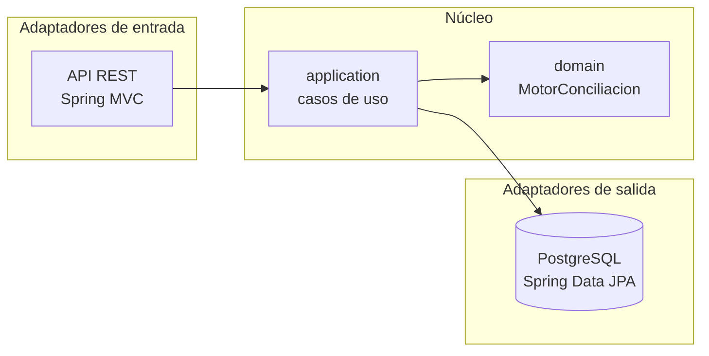

# Nexora
**Plataforma web de conciliación financiera multicanal para pymes**
Proyecto de Introducción a la Ingeniería — FESC, 2026

> Nexora no se limita a decir "falta plata": **explica** cada diferencia.
> Ante una venta de **$250.000** con un abono bancario de **$241.500**, el sistema
> identifica **$7.500 de comisión** de pasarela y **$1.000 de retención**.

---

## Arquitectura: Hexagonal (Ports & Adapters)

La lógica de negocio (dominio) está **aislada** del framework, la base de datos y la web.
Las dependencias siempre apuntan **hacia el dominio**, nunca al revés.



#### Estructura de paquetes

```
nexora_backend/
├── domain/                  ← Reglas de negocio puras (Java sin Spring)
│   ├── model/               ← EstadoConciliacion, ResultadoConciliacion
│   ├── repository/          ← Puertos (interfaces) hacia la persistencia
│   └── service/             ← MotorConciliacion
├── application/             ← Casos de uso que orquestan el dominio
│   ├── dto/
│   └── usecase/
└── infrastructure/adapter/
    ├── in/web/              ← Controladores REST
    └── out/persistence/     ← Implementación con JPA + PostgreSQL
```

**¿Por qué hexagonal?**
- El dominio se prueba en **milisegundos**, sin levantar Spring ni la base de datos.
- Se pueden agregar canales nuevos (voz, WhatsApp, bot telefónico) como adaptadores **sin tocar el núcleo**.
- Cambiar de base de datos solo afecta a `out/persistence`.

---

## Pruebas unitarias

Herramienta: **JUnit 5**. Para los casos de uso se usará **Mockito**, que simula los repositorios.
Metodología: **TDD**: primero se escribe la prueba, se ve fallar y luego se implementa.

| Prueba | Escenario | Resultado esperado |
|---|---|---|
| `explicaComisionYRetencion` | Venta $250.000, abono $241.500, comisión 3 %, retención 0,4 % | Comisión $7.500, retención $1.000, `DIFERENCIA_EXPLICADA` |
| `ventaSinComisionesQuedaConciliada` | Pago en efectivo de $100.000 | `CONCILIADA` |
| `detectaDineroFaltante` | Venta $250.000, abono $239.500 | $2.000 sin explicar, `INCONSISTENTE` |

**Decisión técnica:** los montos usan `BigDecimal` con 2 decimales y redondeo `HALF_UP`,
nunca `double`, para evitar errores de redondeo con dinero (equivale a `DECIMAL(14,2)` en PostgreSQL).

### Ejecutar las pruebas

```bash
./mvnw test -Dtest=MotorConciliacionTest
```

---

## Stack

| Capa | Tecnología |
|---|---|
| Backend | Java 17, Spring Boot 4, Spring Data JPA |
| Base de datos | PostgreSQL 18 |
| Pruebas | JUnit 5, Mockito |
| Gestión | Scrum en Atlassian Jira, Git + GitHub |

## Cómo ejecutar

1. Tener PostgreSQL con una base llamada `nexora_db`.
2. Definir la variable de entorno `DB_PASSWORD` (la contraseña **no** está en el código).
3. Ejecutar:
   ```bash
   ./mvnw spring-boot:run
   ```

## Estado del proyecto

- [x] Esqueleto Spring Boot con conexión segura a PostgreSQL
- [x] Arquitectura hexagonal
- [x] Motor de conciliación con desglose de comisión y retención + pruebas
- [ ] Entidades JPA y repositorios
- [ ] API REST
- [ ] Importación de archivos CSV
- [ ] Frontend React
